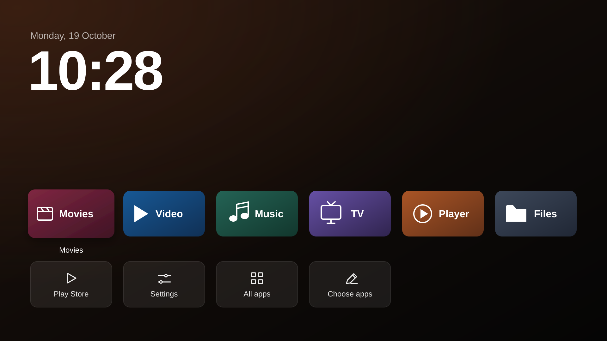

# Mi Box Calm Home

A minimal Android TV home screen based on [Ansub/tv-detox](https://github.com/Ansub/tv-detox), customized for Xiaomi Mi Box.

The top row shows **up to six apps**: by default your six most-used apps, or up to six installed apps you choose yourself. A large live clock/date and dark orange-to-black background keep the screen simple. Play Store, Settings, All apps and Choose apps stay available underneath. The interface follows the TV's language: Portuguese on a Portuguese TV, English otherwise. There are no ads, sponsored recommendations or HDMI shortcuts.



*Design preview. The example app tiles illustrate the layout; your apps come from your usage or your own choice.*

## Set up with Claude Code or Codex

Open this repository in a local **Claude Code** or **Codex** session that can run Windows PowerShell and reach your TV on the same network. Replace `[TV_IP]` below, then paste the prompt. This authorizes the documented automatic setup without approval before each change; Android's debugging authorization still needs a tap on the TV. For individual approvals, use the [guided prompt](REPLICATE-PROMPT.md) instead.

```text
Help me set up Calm Home on my Xiaomi MIBOX4 running Android 9.
TV IP: [TV_IP]
Repository: https://github.com/LuisBadal0/mi-box-calm-home

Read README.md, AUTOMATIC-SETUP.md and Install-CalmHome-Unattended.ps1 first. Use the included calm-home.apk; verify its SHA-256 against BUILD-INFO.json and the installer. Confirm the target is MIBOX4, Android API 28, user 0 before making changes. Stop on a mismatch or unexpected existing configuration instead of guessing or substituting an APK.

Help me enable developer/USB/network debugging if necessary. Use Google's official Android Platform Tools and Windows PowerShell 7. Tell me exactly what to select on the TV, and wait for me to accept "Allow USB debugging?" before proceeding. Do not bypass Android authorization or Play Protect.

I authorize the documented automatic setup on this target without asking before each step. Run:
pwsh -NoProfile -File .\Install-CalmHome-Unattended.ps1 -TvIp [TV_IP] -CloseWifiDebugging

Create this box's own app inventory, original-settings/readable-APK backups and undo journal before changes. Install/open the reviewed launcher and enable only its Usage Access, recording the original mode for undo. Let it start with the automatic row of up to six most-used launchable apps using Android foreground-time history for the last 30 days. Keep the clock, orange-to-dark design, Play Store, Settings, All apps and Choose apps. Explain the local-launch/alphabetical fallback if usage history is unavailable, and that I can switch to my own six apps on the TV with Choose apps; do not pass a fixed app list.

Disable only verified Xiaomi analytics and, if necessary after testing Home, the specific stock Google Home launcher. Keep both installed. Turn off animations and screensaver, preserve the TV's original sleep times, and protect Google Play/services, keyboard, Bluetooth, HDMI and accessibility settings. Never uninstall, clear data, root, flash, bulk-disable, grant accessibility/admin access or transfer accounts.

Skip completed steps. Restart when changes were made, verify Home and protected settings afterward, and show available/unused RAM before and after. Close Wi-Fi debugging only after all checks pass. If setup fails, stop, record the error and use the documented recovery without expanding scope. Finish with the results, backup limitations, and this box's report/UNDO.md paths.
```

The longer [automatic prompt](REPLICATE-NO-PROMPTS.md) and [setup guide](AUTOMATIC-SETUP.md) describe the same scope.

## How apps are selected

Select **Choose apps** on the TV to pick how the top row is filled:

- **Most-used apps (automatic)**, the default: the six apps you use most, as described below.
- **Apps I choose**: tick up to six installed apps. The row keeps the order you picked them in. A chosen app that is later uninstalled or disabled is simply left out; nothing replaces it automatically. Open Choose apps again to change the selection or switch back.

In the automatic mode, with **Usage Access**, Calm Home asks Android for app usage aggregated over the last 30 days and sorts launchable apps by total foreground time. Android keeps daily records for only about ten days and summarizes older days into weekly or monthly records, so the edges of the window are approximate. Ties use most recent usage, local launch history, then app name.

Both installed and preinstalled launchable apps are eligible in both modes. Home launchers, Play Store, Settings and TV-input tools are excluded from the row. Uninstalled or disabled apps disappear automatically. The row refreshes when you return Home and when packages change.

On a fresh TV without recorded usage, apps start in alphabetical order. If Usage Access is unavailable or revoked, the automatic row uses successful launches from Calm Home, with recency and alphabetical tie-breaks. That fallback counts launches since this version was installed; it cannot see time spent in apps or launches from other screens. **All apps** lets you open an app outside the row. No app names are configured at install/build time.

## Supported automatic setup

The Windows installer supports **Xiaomi MIBOX4, Android 9 / API 28, user 0**. It stops on unsupported devices, Projectivy, unexpected Home configurations, or a different existing Calm Home build. The launcher's Android minimum is API 21; that does not make the automatic setup compatible with other boxes.

Install [PowerShell 7](https://github.com/PowerShell/PowerShell/releases) and download Google's [Android Platform Tools](https://developer.android.com/tools/releases/platform-tools). Extract `platform-tools` beside the installer. Keep the computer and TV on the same trusted local network.

On the TV, open Settings > Device Preferences > About and press Build seven times to enable Developer options. Enable USB debugging, and network debugging if the box exposes a separate switch. Keep the TV awake on its HDMI input. From this repository folder, replace the example IP:

```powershell
pwsh -NoProfile -File .\Install-CalmHome-Unattended.ps1 -TvIp 192.168.1.20
```

The installer prints the tap instructions and waits up to three minutes for **Allow USB debugging?** on the TV. Select **Always allow from this computer**, then **Allow**. Already authorized connections continue immediately. Add `-AuthorizationWaitSeconds 300` for five minutes.

Running this command authorizes its documented automatic changes, including enabling **Usage Access for Calm Home**. To approve changes individually, use [FRESH-BOX-SETUP.md](FRESH-BOX-SETUP.md). See [AUTOMATIC-SETUP.md](AUTOMATIC-SETUP.md) for the complete scope and failure behavior.

```powershell
# Read-only inventory and plan; does not install, grant access or change settings.
pwsh -NoProfile -File .\Install-CalmHome-Unattended.ps1 -TvIp 192.168.1.20 -PlanOnly

# Close wireless ADB only after successful setup and verification.
pwsh -NoProfile -File .\Install-CalmHome-Unattended.ps1 -TvIp 192.168.1.20 -CloseWifiDebugging
```

## What the installer changes

- Saves original settings, package state, readable APKs, an English inventory and per-box undo instructions.
- Installs the included reviewed APK and grants local Usage Access, recording its original mode for undo.
- Opens and verifies the clock and the Play Store, Settings and All apps buttons (in English or Portuguese) before replacing Home. It always starts in the automatic most-used mode.
- Disables Xiaomi analytics and, only if needed for Home to work, the stock Google Android TV launcher. Both remain installed.
- Turns off animations and screensaver, while preserving original screen-off/sleep times, Google Play, keyboard, Bluetooth, HDMI and accessibility settings.
- Restarts when changes were made, verifies persistence and records available/unused RAM before and after. RAM readings fluctuate and are not a speed benchmark.

It does not install other apps, transfer accounts, clear app data, uninstall, root, flash, or grant accessibility/device-admin access.

## Usage Access and privacy

This version declares `android.permission.PACKAGE_USAGE_STATS`. Usage Access lets it read which apps were used and when/how long they were in the foreground. It requests **no Internet permission**, sends no usage data online and runs no tracking service. Ranking data is read from Android into memory; local launch counts/timestamps stay in Calm Home's private preferences.

The automatic installer enables `GET_USAGE_STATS` through ADB and records an undo command. For manual installation, choose **Choose apps > Usage access > Open settings**, then enable Calm Home. Usage Access is not needed if you only use **Apps I choose**. Some Mi Box firmware has no usage-access settings screen; use the documented ADB command in the guided guide instead.

Revoke access in Android Settings or restore the original app-op mode using your run's `UNDO.md`. Calm Home continues with the local-launch fallback. See [Android's UsageStatsManager documentation](https://developer.android.com/reference/android/app/usage/UsageStatsManager).

## Backup, recovery and existing installations

Each run writes to `tv-backup/unattended-<IP>-<timestamp>/`. Keep its **UNDO.md** and `journal.json`. Before disabling Calm Home during rollback, restore and verify the original launcher. Do not apply another box's original values.

Backups contain settings, package state and readable APKs, not firmware or private app/account data. Vendor APKs can be unreadable. Network interruptions can stop setup or recovery. Inspect the recorded error and actual TV state before retrying. If wireless debugging was closed, enable it on the TV again before remote management.

The installer will not overwrite a different existing Calm Home APK automatically. To update your own older build deliberately, follow the guided guide's upgrade section. Version 1.1 ignores/removes the old saved fixed-app-list preference; Android usage now determines the row. No TV has been updated merely by publishing this repository.

## APK and source

- Package: `com.luisbadalo.calmhome`
- Version: **1.1-most-used**, versionCode **2**
- SHA-256: `A5F9826B19B0CC0A538247BCC9233148A7610A7A75ACC5DC7C71380B8D5F2B3B`
- Source: [launcher/](launcher/); release notes: [CHANGELOG.md](CHANGELOG.md)
- Upstream: Ansub/tv-detox at `4cdbf068c76d7bc5b5adc070c42b8f924cabcc0d`

Rebuilding needs Java 17 and Android SDK platform 34 / build-tools 34.0.0. On Windows set `JAVA_HOME` and `ANDROID_HOME`, then run `pwsh -NoProfile -File .\launcher\Build-Windows.ps1`. On macOS/Linux, also install `zip`, then run `cd launcher` and `sh build.sh`.

The build creates `launcher/out/calm-home.apk` and creates a local signing key if missing. Generated development keys use the password `local-build-only`; Windows supports `CALM_HOME_KEY_PASSWORD` and shell builds support `KEYSTORE_PASS` to override it. Keep signing keys private and preserve the same key for updates. Rebuilt APKs need their own review and checksum update in the installer/docs before automatic deployment. A new signing key cannot update the included APK in place. Windows installation of the included APK needs no Java/build tools.

## License

MIT; see [LICENSE](LICENSE). Modified from Ansub Khan's TV Detox. App banners/icons are loaded from installed apps and belong to their respective owners. This repository does not distribute third-party app artwork, tests, TV backups or private signing/debugging keys.
